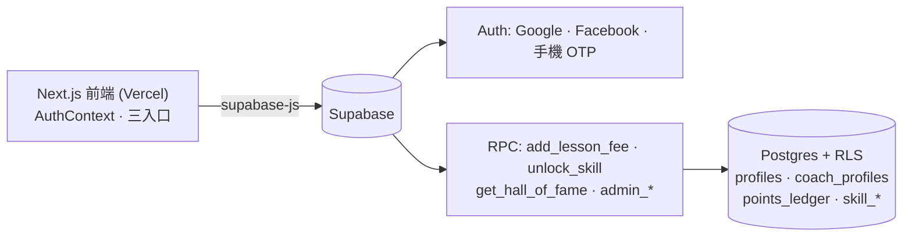

# 全藝 NEXT U — 整合與部署指南

## 架構

安全原則：前端只能「讀自己的資料」，所有點數/經驗/角色的寫入都經 RPC，由資料庫驗證。

## A. 本機啟動
1. `npx create-next-app@latest nextu --ts --tailwind --app`，把本資料夾檔案複製進去（`app/layout.tsx` 若已有字型設定，只需加上 `<AuthProvider>`）。
2. `npm i @supabase/supabase-js @supabase/ssr lucide-react react-icons`
3. 複製 `.env.local.example` 為 `.env.local`，填入：
   ```env
   NEXT_PUBLIC_SUPABASE_URL=your-supabase-url
   NEXT_PUBLIC_SUPABASE_ANON_KEY=your-supabase-anon-key
   ```
   只放 anon key，**絕不可**放 service_role key。
4. Supabase SQL Editor 貼上並執行 `supabase/schema.sql`（單一完整腳本，可重複執行）。
5. `npm run dev`，開 http://localhost:3000

## B. 建立測試資料（SQL Editor 執行，換成實際 uuid）
先用 Google 登入一次，到 Authentication → Users 複製自己的 uuid：
```sql
-- 變成管理者
update public.profiles set role = 'admin' where id = '你的-uuid';
-- 讓另一個帳號變教練（SQL Editor 沒有登入身份，不能用 admin_set_role，直接寫入）
update public.profiles set role = 'coach' where id = '教練-uuid';
insert into public.coach_profiles (id, coach_code, rank_tier, current_exp, training_points, total_hours)
values ('教練-uuid', 'ch-08', 'junior', 1840, 3200, 412);
```

## C. Supabase 設定
1. Authentication → URL Configuration：Site URL 填正式網域；Redirect URLs 加入
   `http://localhost:3000/auth/callback` 與 `https://你的網域/auth/callback`。
2. Providers → Google：Google Cloud Console 建立 OAuth Client（Web），
   Authorized redirect URI 填 `https://<專案代號>.supabase.co/auth/v1/callback`，再把 Client ID/Secret 貼回 Supabase。
3. Providers → Facebook：同上流程（Meta for Developers）。Supabase 沒有內建 Instagram。
4. Providers → Phone：啟用並填入簡訊服務（如 Twilio）金鑰。

## D. Vercel 部署
1. 程式碼推到 GitHub。
2. vercel.com → Add New → Project → 匯入該 repo（自動辨識 Next.js）。
3. Environment Variables 填入上方兩個變數（Production / Preview / Development 都勾）。
4. Deploy，取得網域後回到 C-1 補上 Redirect URL，並將 Site URL 改為正式網域。
5. 驗收清單：
   - 登入後依角色進入正確入口
   - 教練按「新增一堂課」→ 重新整理後點數仍在，`points_ledger` 有新紀錄
   - 在瀏覽器主控台嘗試 `supabase.from('coach_profiles').update({training_points: 99999})` → 應被拒絕
   - 管理者切換教練狀態 → 名人堂顯示即時改變
